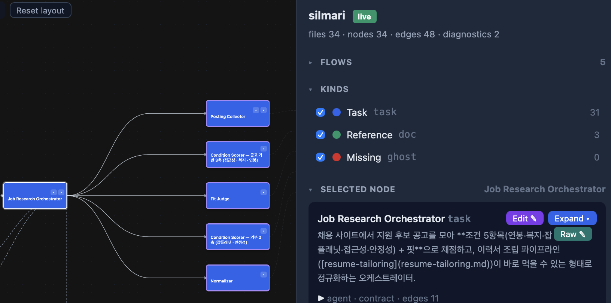

# Viewer

[← README](../README.md)

Run `sil view`, or use **silmari: Show graph** in VS Code. The CLI viewer redraws when a document changes.

## Views

- **Graph:** documents and their calls. It starts with calls only; use the legend to show references and file data.
- **A:** steps run left to right, with called documents below each step. A called flow appears inside its caller.
- **B:** one lane per document, with calls and replies laid out from left to right.

The rail button cycles through the three views. The flow views use document order and explicit links; they do not infer branches or loops from prose.

## Navigate

| Control | Action |
|---|---|
| Entry flows / All md files | Follow registered entry points, or browse all documents |
| ▸ / ▸▸ / ◂ on a node | Show children, expand everything below it, or fold it |
| ▸▸ on a flow | Open that flow on its own |
| Click a document | Read its prompt and related documents in the side panel |
| Click a heading | Focus the calls under that heading |
| Drag / zoom | Move around the canvas; use the wheel to zoom |
| ⌥ / ☰ in the rail | Arrange labels by target or by document order |
| Drag a label / ↺ | Move it, or restore its automatic position |

A `+1 outside` badge means another flow also calls that document. The diagnostics panel reports findings in documents outside the current view.

## Lines and files

Solid grey lines are calls; dashed lines are references; teal lines carry file writes and imports. Purple marks subagent calls. An amber **no rules** badge marks `{{-…}}` calls. Missing targets stay red even when other line groups are hidden.

Selecting a document reveals its file data, even when the file-data filter is off. The side panel lists all of its relationships. A hollow file node is a planned output; a template target such as `out/{{>job-id}}.json` represents files selected at runtime.

## Edit and save

**Edit** changes heading bodies; **Raw** edits the whole Markdown file. Saving checks the file hash and takes a backup. A stale edit is refused so it cannot overwrite a newer change.

Per-user positions, labels, folds and panels are stored in `.sil/layout.json`. Add that file to `.gitignore`.
