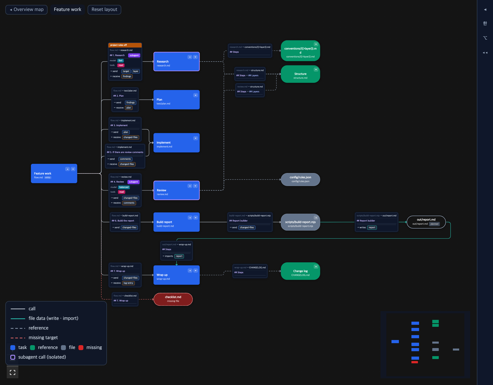

<!-- Generated from README.md at the repository root by tools/readme.mjs. Edit that file, then run: pnpm readme -->
<p align="center"></p>

<h1 align="center">silmari</h1>
<h3 align="center">Keep your docs talking to each other.</h3>

**Lint and visualize the Markdown files that coordinate your AI agents.**

Find broken links and mismatched inputs, see how documents connect, and run individual subagent steps through Claude Code or Codex CLI.
Any agent can read the documents. The notation uses symbols; the words inside are yours, in any language.

| Command | What it does |
|---|---|
| `sil lint` | Check links, inputs, outputs and calls between documents |
| `sil view` | Explore the flow as a graph or a sequence of steps |
| `sil run` | Start one subagent step with the declared tools, model and approvals |

## Install

```sh
npm install -g silmari
```

Requires Node.js 20+. Try `npx silmari lint` without installing, or install the [VS Code extension](https://marketplace.visualstudio.com/items?itemName=mogiyoon.silmari-vscode) for live diagnostics and the viewer.

## Quick start

```sh
cd my-agent-project
sil init   # create SILMARI.md and connect your agent's start file
sil lint   # check the documents
sil view   # open the interactive graph
```

Your agent reads `SILMARI.md` to learn the notation and find the flow documents. If you already have agent docs, `sil init` prepares a migration guide and a backup.

## A flow in Markdown

A call looks like this:

```markdown
## 1. Research ((use a subagent via sil run))
Call [researcher](agents/researcher.md) with {{>topic}} and receive {{<findings}}.
Use the tool {{+read}} and the model {{#fast}}.
```

Links call documents. `{{>…}}` sends a value, `{{<…}}` receives one, and `((…))` marks a subagent step. The called document declares its inputs and outputs.

Your agent follows the flow and uses `sil run` for subagent steps:

```sh
sil run claude --step flow.md#1 --send topic="release notes" --model haiku --tools Read
```

Start with the [complete two-file example](https://github.com/mogiyoon/silmari/blob/main/docs/getting-started.md), or explore the [studio](https://github.com/mogiyoon/silmari/blob/main/examples/studio) and [pipeline](https://github.com/mogiyoon/silmari/blob/main/examples/pipeline) examples.

## The graph



Show calls, references or file data; switch between the graph and two flow views. Click a document to read or edit it in the side panel. See the [viewer guide](https://github.com/mogiyoon/silmari/blob/main/docs/viewer.md).

## Commands

| Command | Use it to |
|---|---|
| `sil lint --strict` | Fail CI when a document has an error |
| `sil run --help` | See runtime flags and input formats |
| `sil update` | Refresh project guidance after upgrading silmari |
| `sil backup` | Back up the project's Markdown files |
| `sil migrate` | Prepare migration guidance again |

Add `{{!…}}` to a call to declare commands it may run without asking. For Claude, the orchestrator supplies scoped `--allowedTools` rules; Codex refuses declarations it cannot enforce. Any reported approval denial fails the run. See [running steps and approvals](https://github.com/mogiyoon/silmari/blob/main/docs/running.md).

## Documentation

<a id="your-first-flow"></a><a id="using-it"></a><a id="notation-nine-symbols"></a><a id="notation-seven-symbols"></a>
<a id="running-a-step-sil-run"></a><a id="what-lint-catches"></a><a id="configuration"></a><a id="migrating-existing-documents"></a>
<a id="use-it-from-javascript"></a><a id="what-it-never-does"></a><a id="development"></a>

| Guide | Covers |
|---|---|
| [Getting started](https://github.com/mogiyoon/silmari/blob/main/docs/getting-started.md) | A complete flow and its worker document |
| [Notation](https://github.com/mogiyoon/silmari/blob/main/docs/notation.md) | All nine symbols, contracts and value types |
| [Running steps](https://github.com/mogiyoon/silmari/blob/main/docs/running.md) | Claude/Codex flags, approvals, rules and caching |
| [Viewer](https://github.com/mogiyoon/silmari/blob/main/docs/viewer.md) | Views, filters, navigation and editing |
| [Lint reference](https://github.com/mogiyoon/silmari/blob/main/docs/lint.md) | Diagnostic codes and CI output |
| [Project setup](https://github.com/mogiyoon/silmari/blob/main/docs/configuration.md) | Configuration, migration and upgrades |
| [JavaScript API](https://github.com/mogiyoon/silmari/blob/main/packages/core/README.md) | Use the checker in Node.js or a browser |
| [Contributing](https://github.com/mogiyoon/silmari/blob/main/CONTRIBUTING.md) | Build, test and package the project |

## License

[MIT](https://github.com/mogiyoon/silmari/blob/main/LICENSE)

Documentation and examples: https://github.com/mogiyoon/silmari#documentation
